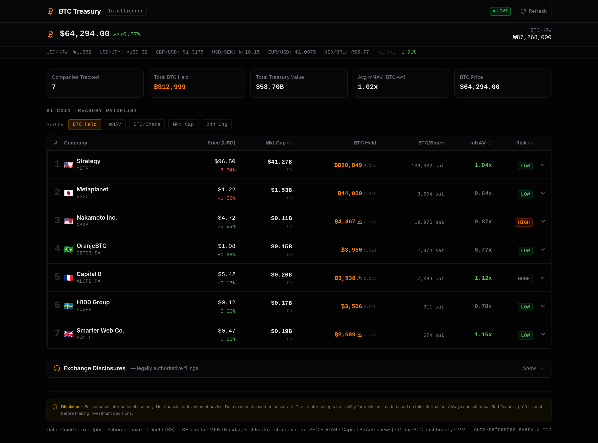

# BTC Treasury Intelligence

An open-source dashboard for comparing public companies that hold Bitcoin on their balance sheet — not just raw BTC counts, but **mNAV**, **BTC per share**, **debt coverage**, and the regulatory disclosures behind the numbers.

**Live dashboard:** [https://treasury.bjunjo.com](https://treasury.bjunjo.com)



This is a personal research watchlist. If it's useful to you, fork it.

---

## About the author

**빌리조** researches long-term investing and built this dashboard with AI as a non-developer — a working example of using AI to ship a real research tool.

- Portfolio: [billyjo-portfolio.vercel.app](https://billyjo-portfolio.vercel.app)
- YouTube: [youtube.com/@bjunjo](https://www.youtube.com/@bjunjo)
- Substack: [billyjo.substack.com](https://billyjo.substack.com)

---

## Why This Exists

Most Bitcoin-treasury trackers are either too simple (just a BTC count) or too opaque about where their numbers come from. This dashboard is built to:

- Use **mNAV** (market-implied premium over BTC NAV) as the primary lens, not just raw BTC count
- Source data from **legally authoritative filings and issuer APIs** wherever possible — SEC EDGAR, company IR pages, LSE, MFN, strategy.com — not just scraped news
- Be **conservative and explicit** on market cap: for Strategy, market cap comes from the official strategy.com API (Basic Shares Outstanding × price). For other companies, it is computed as price × the share count described below, and labeled FD in the UI
- Be **transparent** about what's live vs. a hardcoded fallback, via per-field confidence flags (`LIVE`, `STALE`, `FALLBACK`, `HARDCODED`)

---

## Companies Tracked

Seven companies are on the live watchlist (sorted by BTC held on the dashboard):

| # | Company | Ticker | Exchange | Country |
|---|---------|--------|----------|---------|
| 1 | Strategy | MSTR | Nasdaq | 🇺🇸 USA |
| 2 | Metaplanet | 3350.T | TSE (Tokyo) | 🇯🇵 Japan |
| 3 | Nakamoto Inc. | NAKA | Nasdaq | 🇺🇸 USA |
| 4 | OranjeBTC | OBTC3.SA | B3 (Bovespa) | 🇧🇷 Brazil |
| 5 | Capital B | ALCPB.PA | Euronext Growth Paris | 🇫🇷 France |
| 6 | H100 Group | HOGPF | Nasdaq First North | 🇸🇪 Sweden |
| 7 | Smarter Web Co. | SWC.L | LSE AIM | 🇬🇧 UK |

Holdings, prices, and multiples on the live site change with the market and with new filings. The screenshot above is a point-in-time capture.

The UI also shows summary stats (companies tracked, total BTC, total treasury value, BTC-weighted average mNAV), a BTC price strip with the KRW price and kimchi premium, FX rates, sortable columns, expandable rows with a debt breakdown, and an exchange-disclosure feed.

---

## Metrics Explained

### mNAV (Modified Net Asset Value multiple)

> mNAV = Enterprise Value ÷ BTC Treasury Value

This is the core metric. It tells you how much premium (or discount) the market is pricing in over the company's raw Bitcoin holdings. A value of 1.0x means the market values the company exactly at its BTC. Above 1.0x means a premium for the equity wrapper — which may be justified by leverage, future accumulation capacity, or the "Bitcoin treasury" brand.

For Strategy (MSTR), mNAV is taken from the official `strategy.com` API when available (`bitcoinKpis` / `mNav`). Otherwise Enterprise Value is sourced from the `mstrKpiData` endpoint. For other companies, EV is computed as: `FD Market Cap + Net Debt` (plus preferred stock when present).

### Market Cap

Market cap is displayed in **billions of USD** to two decimal places (e.g. `$45.94B`, `$0.21B`). For MSTR, this is the live value from strategy.com — Basic Shares Outstanding × price, matching what Bloomberg and companiesmarketcap.com report. For other companies, it is computed as `Price × share count` (StrategyTracker or company-reported shares when live; otherwise the latest hardcoded fully diluted count) and labeled FD in the UI.

**Why the distinction matters:** Strategy has issued multiple tranches of convertible notes, preferred stock (STRK, STRF), and ATM equity offerings. The gap between basic and fully diluted shares is meaningful. Market cap for MSTR uses the basic, official figure; BTC/share uses the live share count implied by strategy.com's published sats-per-share.

### BTC/Share (in satoshis)

How many satoshis of Bitcoin exposure one share of equity represents. Useful for comparing accumulation efficiency across companies of different sizes. 1 BTC = 100,000,000 satoshis. The table also shows each company's BTC as a percentage of the 21M cap.

### Risk Label

Based on BTC treasury coverage of total debt (`BTC Treasury Value ÷ Total Debt`):

| Label | Coverage |
|-------|----------|
| `LOW` | BTC treasury ≥ 5× debt |
| `MOD` | 2× – 5× debt |
| `HIGH` | 1× – 2× debt |
| `CRIT` | < 1× debt |
| `NONE` | No debt |

---

## Data Sources

The data layer follows a strict source hierarchy — **authoritative sources first, fallback last**. The same principle used by professional market-data terminals: prefer the company's own regulatory filings and official APIs over third-party aggregators.

| Tier | Source | Used For |
|------|--------|----------|
| 0 | [strategy.com API](https://api.strategy.com/btc/mstrKpiData) (`mstrKpiData`, `bitcoinKpis`) | MSTR market cap, EV, official mNAV, debt, preferred, BTC holdings, implied share count |
| 0 | [SEC EDGAR](https://www.sec.gov/cgi-bin/browse-edgar) | MSTR & NAKA 8-K (and related) disclosures |
| 0 | [MFN](https://mfn.se) RSS | H100 Group press releases (Nasdaq First North) |
| 0 | [OranjeBTC dashboard API](https://www.oranjebtc.com/api/dashboard?currency=usd) | OranjeBTC BTC holdings, share count, net debt |
| 0 | [StrategyTracker](https://data.strategytracker.com/latest.json) partner feed | Live BTC, shares, and market cap for Metaplanet, H100, and Smarter Web Co. |
| 1 | [metaplanet.jp disclosures](https://metaplanet.jp/en/disclosures) | Metaplanet English IR filings (shown in the UI as TSE / TDnet) |
| 1 | [LSE alldata](https://www.londonstockexchange.com) | Smarter Web Co. RNS filings |
| 1 | Capital B press releases (Actusnews / company IR) | Hardcoded BTC, shares, and cash used when no live holdings API is wired |
| 2 | [Yahoo Finance](https://finance.yahoo.com) | Stock prices; FX rates (USD/KRW, USD/JPY, GBP/USD, USD/SEK, EUR/USD, USD/BRL) |
| 2 | [CoinGecko](https://www.coingecko.com) | BTC/USD price (primary) |
| 2 | [Binance](https://www.binance.com) / [Coinbase](https://www.coinbase.com) | BTC/USD fallbacks if CoinGecko fails |
| 2 | [Upbit](https://upbit.com) | BTC/KRW price (kimchi premium) |
| 3 | Hardcoded last-known-good values | Fallback when live APIs are unavailable |

Disclosure feeds (SEC EDGAR, metaplanet.jp, LSE, MFN) are fetched on each cache refresh. In-memory cache TTL is **30 minutes** when all live sources succeed, and **2 minutes** if any fallback is present so a transient outage is retried sooner. The UI auto-refreshes every 5 minutes. A daily forced refresh runs at 06:30 UTC (after the Tokyo close).

---

## Architecture

```
server/treasury.ts         ← Data fetching, computation, in-memory cache
server/routers.ts          ← tRPC procedures (`treasury.getData`)
server/_core/index.ts      ← Express server, SEO routes, daily refresh cron
client/src/pages/Home.tsx  ← Dashboard UI
```

**Stack:** React 19, Tailwind 4, tRPC 11, Express 4, Vite, TypeScript, pnpm. No database is required for market data — values are fetched live from public APIs and cached in process memory.

**Deployed on [Fly.io](https://fly.io)** (Docker, Node 22, region `iad`) at [treasury.bjunjo.com](https://treasury.bjunjo.com).

**Key design decisions:**

- **No database for market data.** Everything is fetched fresh and cached in-process, so the deployment stays simple and data is never stale beyond the TTL.
- **Parallel fetching.** All API calls within a refresh cycle run concurrently via `Promise.all` / `Promise.allSettled`, so a single slow source doesn't block the others.
- **Graceful degradation.** Every data point has a hardcoded fallback. If strategy.com is down, the dashboard still loads with last-known values and marks them accordingly.
- **First-principles computation.** mNAV, BTC coverage, and BTC/share are computed from raw inputs — not scraped from aggregators — so every number can be audited back to its source.
- **First-visit legal disclaimer**, plus a persistent footer disclaimer, before the data is used as a research tool.

---

## Known Limitations

- **Debt and cash for Metaplanet, H100, Smarter Web Co., and Capital B** come from hardcoded last-known filings, not a live debt API. OranjeBTC net debt is live from the company dashboard. MSTR debt, preferred, and cash come from strategy.com.
- **Capital B BTC and share count** are hardcoded from company press releases (September / October 2026). No live holdings API is wired yet.
- **Nakamoto BTC, fully diluted shares, and debt** are taken from the latest reviewed SEC filings in code (Q2 2026 results). Automatic S-3/8-K text and XBRL overrides were removed because they could pick up pledged-BTC figures or miss post-sale reductions.
- **The disclosure feed** covers Strategy and Nakamoto (SEC EDGAR), Metaplanet (metaplanet.jp), Smarter Web Co. (LSE), and H100 (MFN). Capital B and OranjeBTC are not in that feed yet.
- **Thinly traded quotes** (notably H100's OTC ticker `HOGPF`) may be marked `STALE` when Yahoo's last tick is several days old; the 24h change is suppressed in that case.

---

## Running Locally

Requires [pnpm](https://pnpm.io). The production Docker image uses Node 22. No API keys are required — market data, prices, and filings are fetched from public sources.

```bash
git clone https://github.com/bjunjo/btc-treasury-dashboard.git
cd btc-treasury-dashboard
pnpm install
pnpm dev
```

The dev server listens on [http://localhost:3000](http://localhost:3000) (or the next free port if 3000 is taken).

---

## Disclaimer

For personal informational use only. This dashboard is a private research tool and does not constitute financial advice, investment advice, trading advice, or a recommendation to buy, sell, or hold any security or cryptocurrency. All data is sourced from third-party APIs and public filings and may be delayed, inaccurate, or incomplete. The creator accepts no liability for decisions made based on this information.

---

## License

MIT — fork it, use it, improve it.
